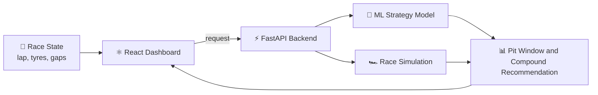

# 🏎️ How My F1 Pit Strategy Predictor Works

> **Live platform:** [f1-strategy-platform.vercel.app](https://f1-strategy-platform.vercel.app/login) · **Built with:** React, FastAPI, Machine Learning
>
> A deep dive into the problem, the system design, and what I learned building it.

<!--
BEFORE YOU PUBLISH: search this file for the word FILL (Ctrl+F).
Every **[FILL: ...]** is something only you know about your project.
Replace each one with your real details, then delete this comment.
-->

---

## 1. The problem

A Formula 1 race is often decided in the pits, not on the straights. Every strategist has to answer one question again and again: **"Do we pit now, or stay out?"**

It's a trade-off between several things pulling in different directions:

| Factor | Why it matters |
|:--|:--|
| **Tyre wear** | Worn tyres get slower every lap. |
| **Pit-stop time loss** | Every stop costs seconds in the pit lane. |
| **Track position** | Coming out behind slower cars can undo the gain from fresh tyres. |
| **Race events** | A safety car can change the best strategy instantly. |

Doing this by hand is slow and instinct-driven. I wanted to see whether a model could make the call from data, in real time.

---

## 2. The system

- **Frontend (React):** the dashboard where you set up the race state and see the recommendation.
- **Backend (FastAPI):** serves the model and the simulation through a REST API.
- **ML model:** predicts the best strategy decision from the race state.
- **Race simulation:** plays the race forward lap by lap to compare strategies.

**[FILL: confirm this diagram matches your real architecture. Add or remove boxes, such as a database, a data pipeline or a caching layer.]**

---

## 3. The data

**[FILL: where the data comes from (for example an F1 data API, Kaggle, FastF1) and how many races/seasons/laps you used.]**

**[FILL: how you cleaned it. Mention anything non-trivial, like removing safety-car laps, handling missing laps or fixing outliers.]**

---

## 4. The features

The model looks at the state of the race at a given lap. **[FILL: list your real input features.]**

> *Examples of the kind of thing to list (only keep what's true for your model):* tyre compound, tyre age, current lap, laps remaining, gap to the car ahead, track position.

---

## 5. The model

- **Type of model:** **[FILL: for example Random Forest, Gradient Boosting, a neural network]**
- **What it predicts:** **[FILL: for example best pit lap, best compound, time gained or lost]**
- **Why I chose it:** **[FILL: one or two honest sentences about why this model fit the problem]**
- **How I trained and validated it:** **[FILL: train/test split, cross-validation, which races were held out]**

---

## 6. Results

| Metric | Value |
|:--|:--|
| **[FILL: metric name, for example accuracy or MAE]** | **[FILL: value]** |
| **[FILL: another metric]** | **[FILL: value]** |
| Response time of the API | **[FILL: for example under X ms]** |

**[FILL: one honest sentence on what these numbers mean in practice, ideally with one real example, like a specific race where the model's call matched or beat what the team did.]**

---

## 7. What I learned

- **[FILL: your biggest technical challenge and how you solved it]**
- **[FILL: something the model got wrong and why]**
- **[FILL: what you'd improve next, for example more seasons of data, weather, a safety-car model]**

---

## 8. Try it

▶ **[Open the live platform](https://f1-strategy-platform.vercel.app/login)**

Built by **[Eahiya A](https://github.com/Eahiya)** · [LinkedIn](https://linkedin.com/in/eahiya-azad-1428b6324) · [Portfolio](https://eahiya-portfolio.netlify.app/)
