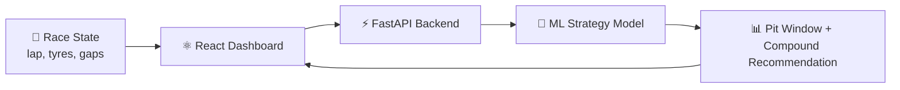

<!-- ======================= HERO ======================= -->
<div align="center">


<a href="https://git.io/typing-svg">
  
</a>

<br/><br/>

<a href="https://eahiya-portfolio.netlify.app/"></a>
<a href="https://linkedin.com/in/eahiya-azad-1428b6324"></a>
<a href="mailto:eahiyaazad@gmail.com"></a>


<br/>


</div>

---

## 🏁 Driver Card

<div align="center">

| | |
|:--|:--|
| 🧑‍💻 **Driver** | Eahiya A |
| 🏫 **Team** | Sri Krishna College of Technology, Coimbatore |
| 🎓 **Programme** | B.E. CSE (AI & ML) · 2024 → 2028 |
| ⚙️ **Power Unit** | Python · FastAPI · React · Scikit-Learn |
| 🎯 **Specialty** | Predictive analytics · Network simulation · NLP |
| 🏎️ **Fuel** | Motorsports, coffee and clean data |
| 🚦 **Status** | 🟢 Green flag: open to SWE / ML internships |

</div>

---

## 👨‍💻 About

```python
class Eahiya:
    role        = "AI & ML Engineer in the making"
    obsessions  = ["Predictive models", "Network simulation", "Clean dashboards", "Formula 1"]
    shipped     = ["ATS career-intelligence AI", "F1 pit-strategy platform", "Uber ride analytics", "Automotive web platform"]
    certified   = ["IBM Data Science", "JHU Practical ML", "GenAI with LLMs (DeepLearning.AI + AWS)"]
    next_lap    = "Land an internship, ship bigger, learn faster"

    def philosophy(self):
        return "Read the data. Make the call. Ship it."
```

---

## 🚀 Projects (all live, all deployed)

### 🧠 AI Career Intelligence · ATS Score Checker
> ML + NLP platform that scores ATS compatibility, recruiter alignment and career positioning, then generates optimisation recommendations.


[](https://neurahire-career-intelligence.vercel.app/)

### 🏎️ Formula 1 Optimal Pit Strategy Predictor
> AI-powered strategy platform for real-time race simulation and pit-stop optimisation.


[](https://f1-strategy-platform.vercel.app/login)



### 🚕 Uberlytics · Ride Analytics of Greater Delhi
> Data cleaning, exploratory analysis and visual storytelling of ride patterns in a dashboard.


[](https://uberlytics.netlify.app/)

### 🚗 Caralyst · Automotive Operating System
> Vehicle discovery, comparison, dynamic search and personalised user features in one web platform.


[](https://caralyst.netlify.app/)

### ✅ Stelvio · Productivity Partner
> Browser-based dashboard with task tracking, a Pomodoro timer and usage analytics.


[](https://stelvio-todolist.netlify.app/)

---

## 🛠️ Tech Arsenal

<div align="center">

**Languages**


**ML & Data**


**Web & Backend**


**Tools & Deployment**


</div>

---

## 🎓 Certifications

<div align="center">

| Certificate | Issuer | Focus |
|:--|:--|:--|
| [IBM Data Science Professional](https://www.coursera.org/account/accomplishments/professional-cert/44AOQMHDW5NX) | IBM | Data analysis, ML, Python |
| [SpaceX Landing Prediction (Capstone)](https://www.coursera.org/account/accomplishments/verify/4ANA2L98S8XN) | IBM | Predictive modelling, classification |
| [Databases & SQL for Data Science](https://www.coursera.org/account/accomplishments/verify/A1HTQDTLDEIM) | IBM | SQL queries, data analysis |
| [Practical Machine Learning](https://www.coursera.org/account/accomplishments/verify/PFMJVJWMR8PA) | Johns Hopkins | Model evaluation, supervised learning |
| [Generative AI with LLMs](https://www.coursera.org/account/accomplishments/verify/O5SHOXC1U8M8) | DeepLearning.AI & AWS | Prompt engineering, LLMs |

</div>

---

## 📊 GitHub Telemetry

<div align="center">


</div>

---

## 🐍 Contribution Snake

<div align="center">
  
</div>

---

## 🏎️ Pit Wall Philosophy

```text
 ┌────────────────────────────────────────────────────────┐
 │  In F1, a 2-second decision decides the race.          │
 │  In ML, a good feature decides the model.              │
 │  Same game: read the data, trust the process, commit.  │
 └────────────────────────────────────────────────────────┘
```

---

## 🤝 Let's Connect

<div align="center">

<a href="https://linkedin.com/in/eahiya-azad-1428b6324"></a>
<a href="https://eahiya-portfolio.netlify.app/"></a>
<a href="https://kaggle.com/eahiya"></a>
<a href="https://www.leetcode.com/eahiyaazad"></a>
<a href="https://twitter.com/eahiyaazad"></a>
<a href="https://instagram.com/eahiyaazad"></a>
<a href="mailto:eahiyaazad@gmail.com"></a>

<br/><br/>


</div>
